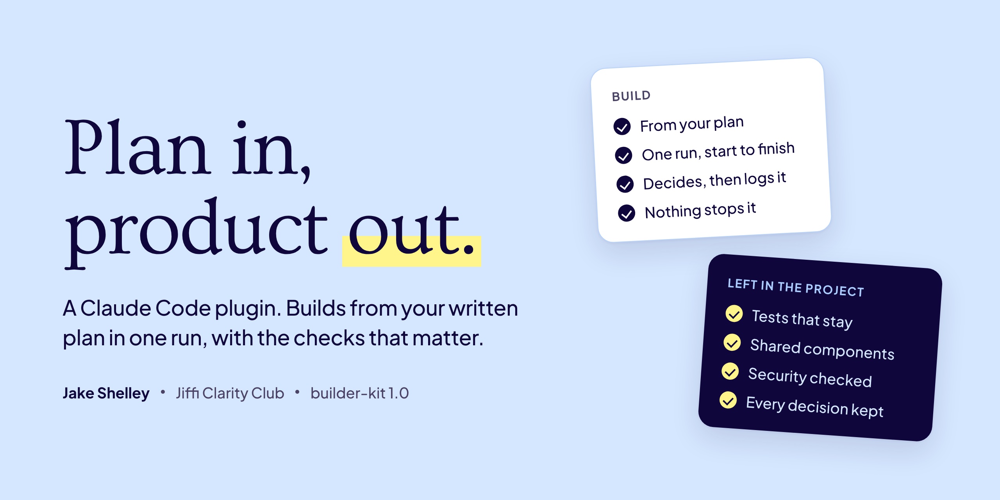

<p align="center">
  
</p>

<p align="center">
  
  <a href="https://github.com/jake-jiffi/build-then-break"></a>
  <a href="https://github.com/jake-jiffi/find-then-doubt"></a>
  <a href="https://clarityclub.jiffi.co"></a>
</p>

# builder-kit

Give Claude Code a written plan. Get back a working product that is set up to last.

This is the quick way to build. One run, no stops, and the minimum checks we'd put on anything.

Claude already builds a small product well from a good plan. Left alone, it also skips things: it leaves nothing saved in git, no record of what it decided for you, no check that runs when the code changes. builder-kit adds that part and stays out of the way of the rest.

- **One run, start to finish.** No phases, no approvals, no questions along the way. Where the plan is silent it decides, and writes the decision down for you to change later.
- **Nothing in it stops a build.** It has one hook, and that hook only lets a short list of safe everyday commands run without a permission prompt.
- **It leaves a foundation.** Tests kept in the project, shared components, security checked, every step saved, every decision recorded.

This is version 1.0, the lean rewrite. The earlier version (0.9) built in phases with gates and is still published at `jiffi-co/claude-plugins`. For the full setup, with one session running a crew of builders, see [workbench](https://github.com/jake-jiffi/workbench).

## Install it in a minute

You need git, Node 22 or later and Claude Code. In a terminal:

```bash
claude plugin marketplace add jake-jiffi/builder-kit-lean
claude plugin install builder-kit@builder-kit-lean
```

Quit Claude Code and open it again. Then, in a project folder that has a plan in it:

```
/builder-kit:build
```

Already have the earlier builder-kit? `claude plugin list` will show `builder-kit@jiffi-claude-plugins`. Remove it first with `claude plugin uninstall builder-kit@jiffi-claude-plugins`. The two share a name and can't run side by side.

Claude Code has its own permission modes. Recent versions start in the automatic mode, which suits a hands-off build. If yours asks before every command, Shift+Tab switches modes. More in [INSTALL.md](plugins/builder-kit/INSTALL.md).

## What you get

A product that runs, and a project you can keep building on:

| In the project | What it is for |
|---|---|
| `README.md` | How to run it and how to check it |
| One check command | Runs the tests, the lint and the browser checks. The same command runs on every push |
| Tests at three levels | The rules, the server, a real browser with an accessibility scan |
| Shared parts | Design tokens, a small set of components, one definition of each rule |
| `docs/acceptance.md` | Every line of the plan as something that can be checked, with how it was checked |
| `DECISIONS.md` | Everything it decided for you, and what the plan left open |
| `CLAUDE.md` | So every later session builds the same way |
| Git history | A commit each time a piece worked |

And a short report at the end: what was built, how to run it, what was found and fixed, what it decided, and what it could not check.

## How it works

| Command | What it does |
|---|---|
| `/builder-kit:build` | Finds the plan, writes the acceptance contract, decides what the plan left open, builds, checks, reports. The only question it ever asks is when there is no plan at all |
| `/builder-kit:check` | Proves a build: the check command, every acceptance line, a real attempt to break it, every screen, security against the OWASP Top 10, the foundation, and one second opinion from two reviewers who didn't build it |
| `/builder-kit:ship` | Going live. The one place it waits for your yes |
| `/builder-kit:iterate` | A change to something that already works |
| `/builder-kit:jiffi-import-idea8` | Files an [idea8](https://clarityclub.jiffi.co/idea8) plan where the build looks for it |

It won't build from one line. A build from one line is a good product for a business that doesn't exist. With no plan, it offers to write a one-page brief for you to correct first.

### It leans on the skills you already have

builder-kit doesn't repeat what another skill does well. It uses each of these when it is installed and carries on without any that aren't.

| When | Skill |
|---|---|
| Every piece of code | [build-then-break](https://github.com/jake-jiffi/build-then-break) |
| A change to something that works | [show-then-build](https://github.com/jake-jiffi/show-then-build) |
| The security review before going live | [find-then-doubt](https://github.com/jake-jiffi/find-then-doubt) |
| Checking screens | [Impeccable](https://impeccable.style) and [UI UX Pro Max](https://uupm.cc) |
| Anything a person will read | [sound-human](https://github.com/jake-jiffi/sound-human) |
| The look | [Brandi](https://github.com/jake-jiffi/brandi) |

The rules that tie them together are in [docs/clarity-rules-lean.md](docs/clarity-rules-lean.md). They go in `~/.claude/CLAUDE.md`.

## How it was tested

The same small product, a shift swap board for a cafe, was built from the same plan and brand by the same model, several ways. Each build was graded by a script written before any build was seen (43 checks), and against 13 yes or no items for the foundation.

| How it was built | Runs | Product checks | Foundation (of 13) | Time |
|---|---|---|---|---|
| The plan, then "build this" | 2 | 43 of 43, twice | 1 and 2 | 16 and 22 min |
| The same, plus one sentence asking for tests, security and shared components | 1 | 43 of 43 | 7 | 34 min |
| builder-kit 0.9 | 2 | 43 of 43, twice | 8, twice | 70 and 115 min |
| builder-kit 1.0 | 3 | 43 of 43, three times | 13, three times | 29, 42 and 45 min |

What this shows, and what it doesn't:

- **The kit doesn't make the product score higher.** Every build that started from the plan passed every check. Claude does that on its own.
- **It does change what is left behind.** The plain builds committed nothing and left no README, no record of decisions and no check on push.
- **It costs about twice the time of a plain build**, and less than half the time of 0.9. The third run, on the kit as published, took 29 minutes.

Full detail in [docs/how-it-was-tested.md](docs/how-it-was-tested.md).

### Limits of this testing

- One small product, three runs. Nothing here says how it does on a large product or a long project.
- The 13 foundation items were written after the plain builds were seen, so they measure "did the build do what was asked", not a blind test.
- The test builds were agents following the skills. They can't fire a plugin's hooks or start its reviewers, so the second opinion never ran in a test. The hook has its own tests.
- It validates and installs in real Claude Code (2.1.325). A full build in real Claude Code, on a Mac or on Windows, is still to be run.

To run the kit's own checks:

```bash
bash plugins/builder-kit/scripts/test/run.sh
```

## What's in the box

```text
plugins/builder-kit/
├── skills/
│   ├── build/        the build, and references/foundation.md
│   ├── check/        the proof at the end
│   ├── ship/         going live
│   └── iterate/      changes to a live product
├── agents/           ac-verifier and security-auditor, the two reviewers
├── commands/         jiffi-import-idea8
├── hooks/            git-allow, the one hook
├── scripts/          the idea8 importer and the kit's tests
└── PRINCIPLES.md     the eight rules the kit is written to
docs/                 the test results and the rules block
assets/               the banner
```

## Credits

- Built at [Jiffi](https://www.jiffi.co) for [Clarity Club](https://clarityclub.jiffi.co), from the earlier builder-kit.
- Partner skills: [build-then-break](https://github.com/jake-jiffi/build-then-break), [show-then-build](https://github.com/jake-jiffi/show-then-build) and [find-then-doubt](https://github.com/jake-jiffi/find-then-doubt).
- Put together by [Jake Shelley](https://github.com/jake-jiffi).

## Licence

To be confirmed.
